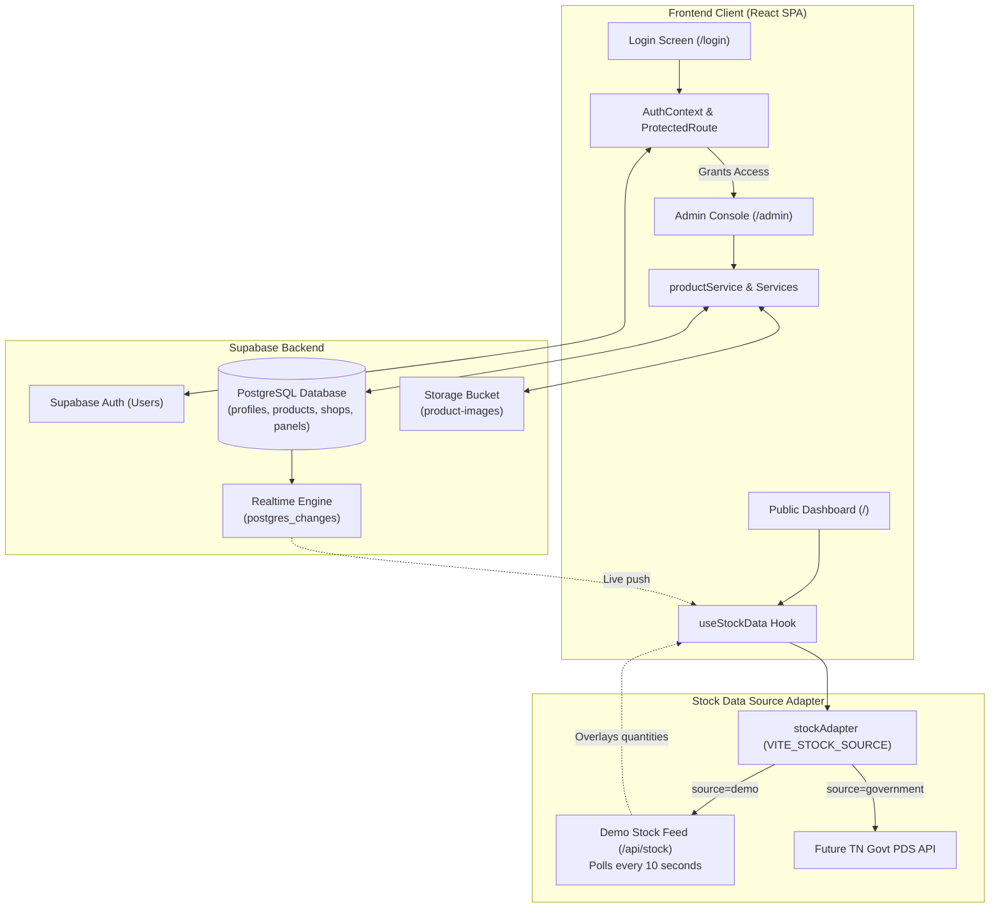

# Tamil Nadu Fair Price Shop Stock Dashboard (Nexlume) with Supabase

A modern, responsive React & Vite dashboard for Tamil Nadu public distribution system (FPS/PDS) outlets featuring inline SVG graphics, live commodity stock monitoring, an integrated Admin console with full product CRUD, Supabase database persistence, Supabase Storage for product images, and secure username-based authentication.

---

## 📑 Table of Contents

- [Overview](#overview)
- [Key Features](#key-features)
- [Project & Folder Structure](#project--folder-structure)
- [Architecture & Current Workflow](#architecture--current-workflow)
- [Supabase Setup & Database Migration](#supabase-setup--database-migration)
- [First Admin Account Creation](#first-admin-account-creation)
- [Storage Bucket & Policies](#storage-bucket--policies)
- [Getting Started (Run Locally)](#getting-started-run-locally)
- [API, Stock Feeds & Adjustments](#api-stock-feeds--adjustments)
- [Future Government API Integration](#future-government-api-integration)
- [Deployment (Vercel & Render)](#deployment-vercel--render)
- [Scripts Reference](#scripts-reference)

---

## 🌟 Overview

The **Nexlume Fair Price Shop Stock Dashboard** displays real-time stock levels of essential commodities (Rice, Sugar, Wheat, Toor Dal, Black Gram, Palm Oil, Green Gram, etc.) for citizens and ration cardholders, accompanied by an administrative portal for inventory and shop display management.

- **Public Stock Dashboard**: Available at `/` (Read-only, live Realtime updates from Supabase)
- **Admin Login**: Available at `/login` (Username & Password authentication with no public signup)
- **Admin Portal**: Available at `/admin` (Protected routes: Dashboard, Products, Shops, Settings)

---

## ✨ Key Features

- **Supabase Database Persistence**: Single source of truth for products, shops, display panels, and profiles. No duplicate stores; changes survive browser restarts.
- **Username & Password Authentication**: Supabase Auth integration without public registration. Passwords verified via Supabase Auth with server-side/RPC username resolution.
- **Admin Product Management (Full CRUD)**:
  - Add, edit, view, and delete commodities.
  - Image upload with live preview via Supabase Storage (`product-images` bucket).
  - Separate numeric stock quantity and unit dropdown (`kg`, `g`, `L`, `ml`, `oz`, `pcs`).
  - Dynamic Shop and Panel foreign-key selection populated from Supabase.
  - Search, filter by shop/panel, and pagination.
- **Shared Realtime User Dashboard**:
  - Automatically receives live product updates via Supabase Realtime subscriptions without manual page reloads.
  - Displays uploaded images with fallback to custom vector graphics.
  - Optional shop and panel filter selector.
- **10-Second Stock Polling**:
  - Live stock quantities refreshed every 10 seconds (10,000 ms) from the stock adapter.
  - Overlays live readings on matching Supabase products without overwriting catalog metadata or writing to Supabase.
  - Client-side 4-second animation removed to ensure data integrity.
- **Government Stock Source Adapter**:
  - Abstraction layer (`src/services/stockAdapter/`) supporting `demo` and future official `government` API sources via `VITE_STOCK_SOURCE`.

---

## 📂 Project & Folder Structure

```text
Nexlume-/
├── .env                              # Environment secrets (Supabase keys, API proxies)
├── .env.example                      # Template for environment configuration
├── .oxlintrc.json                    # Oxlint code linter configuration
├── index.html                        # Main HTML entry point for Vite application
├── package.json                      # NPM dependencies, scripts, and metadata
├── postcss.config.js                 # PostCSS configuration for Tailwind CSS
├── tailwind.config.js                # Tailwind CSS configuration and theme settings
├── vercel.json                       # Vercel deployment and SPA routing rewrites
├── vite.config.js                    # Vite configuration with React plugin and proxies
│
├── api/                              # Vercel Serverless Function entry points
│   ├── stock.js                      # Vercel function routing /api/stock requests
│   └── stock/
│       └── adjustments.js            # Vercel function routing /api/stock/adjustments
│
├── serverless/                       # Shared serverless logic and proxy handlers
│   └── renderStockProxy.js           # Proxy to upstream Render backend with token auth
│
├── server/                           # Local standalone Node.js development API server
│   ├── index.js                      # Local HTTP server handling /api/stock
│   └── private/
│       └── commodities.json          # Local commodity stock JSON dataset
│
├── scripts/
│   └── dev.js                        # Concurrently boots local API server and Vite
│
├── supabase/                         # Supabase database migrations & SQL scripts
│   ├── schema.sql                    # Full consolidated database schema, RLS, & seeds
│   └── migrations/
│       └── 20261026000000_init_nexlume.sql # Initial Supabase migration script
│
├── src/                              # React Frontend Source Code
│   ├── main.jsx                      # React DOM root render mount
│   ├── RootApp.jsx                   # Top-level client router with AuthProvider & ProtectedRoute
│   ├── App.jsx                       # Public Stock Dashboard view layout
│   ├── index.css                     # Global styling and design system
│   │
│   ├── lib/                          # Core Libraries
│   │   └── supabase.js               # Resilient Supabase client (Auth, DB, Storage, Realtime)
│   │
│   ├── context/                      # Global React Contexts
│   │   └── AuthContext.jsx           # Session management, reactive user/profile state
│   │
│   ├── services/                     # Database & API Service Layer
│   │   ├── authService.js            # Username resolution, sign-in, profile & roles
│   │   ├── productService.js         # Supabase products CRUD & storage uploads
│   │   ├── shopService.js            # Supabase shops data service & fallbacks
│   │   ├── panelService.js           # Supabase display panels data service
│   │   └── stockAdapter/             # Pluggable live stock feed adapter
│   │       ├── index.js              # Adapter selector (VITE_STOCK_SOURCE)
│   │       ├── demoAdapter.js        # Local demo JSON stock adapter
│   │       └── governmentAdapter.js  # Future official Tamil Nadu PDS API adapter
│   │
│   ├── pages/                        # Full Page Components
│   │   └── LoginPage.jsx             # Secure Username & Password login page
│   │
│   ├── admin/                        # Admin Management Portal
│   │   ├── AdminApp.jsx              # Main Admin shell, navigation, and routes
│   │   ├── ProductsPage.jsx          # Complete Product Management CRUD page
│   │   ├── admin.css                 # Admin-specific styling and UI components
│   │   ├── context.jsx               # Admin state provider
│   │   ├── storeContext.js           # Store context definitions
│   │   ├── useStore.js               # Hook to access admin store
│   │   └── data.js                   # Default administrative data definitions
│   │
│   ├── components/                   # Reusable UI & Dashboard Components
│   │   ├── ProtectedRoute.jsx        # Auth guard redirecting to /login
│   │   ├── BrandTitleBar.jsx         # Nexlume / Tamil Nadu branding header
│   │   ├── GovHeader.jsx             # Tamil Nadu Government official header
│   │   ├── ShopInfoBar.jsx           # Shop code, district, date and time
│   │   ├── StockTable.jsx            # Core commodity stock table
│   │   ├── StockRow.jsx              # Commodity row with image preview & status badge
│   │   ├── InfoNote.jsx              # Consumer advice & grievance helpline notes
│   │   ├── FooterBanner.jsx          # Official footer banner
│   │   ├── BottomStripe.jsx          # Tricolor accent bottom bar
│   │   └── graphics/                 # Custom SVG commodity & identity illustrations
│   │       ├── EmblemSVG.jsx
│   │       ├── TamilNaduMap.jsx
│   │       ├── RiceBowl.jsx
│   │       ├── SugarBowl.jsx
│   │       ├── WheatBowl.jsx
│   │       ├── ToorDalBowl.jsx
│   │       ├── BlackGramBowl.jsx
│   │       ├── PalmOilBottle.jsx
│   │       └── PeopleIcon.jsx
│   │
│   └── data/                         # Data hooks and stock formatters
│       ├── stock.js                  # Normalization & graphic mapping
│       ├── demoStock.js              # Fallback stock data cycles
│       └── useStockData.js           # Orchestrates Supabase catalog & 10s stock feed
│
└── tests/                            # Automated Node.js test suites
    ├── demoStock.test.js
    ├── renderStockProxy.test.js
    └── stockAdapter.test.js
```

---

## 🔄 Architecture & Current Workflow



---

## 🗄️ Supabase Setup & Database Migration

### 1. Apply Database Schema

Open your Supabase Project Dashboard:
1. Navigate to **SQL Editor** in the left sidebar.
2. Click **New query**.
3. Copy and paste the contents of [`supabase/schema.sql`](file:///supabase/schema.sql).
4. Click **Run**.

This script sets up:
- Tables: `profiles`, `shops`, `panels`, and `products`.
- Automated `updated_at` triggers and performance indexes.
- Helper function `public.is_admin()`.
- Security definer function `public.get_auth_email_by_username()` for secure username resolution.
- Row-Level Security (RLS) policies allowing public reads and restricting mutations to authenticated admins.
- Initial seed records for shops, display panels, and commodities.

---

## 👤 First Admin Account Creation

Because public signup is disabled, the first administrator is provisioned via the Supabase Dashboard:

1. In Supabase Dashboard, go to **Authentication → Users**.
2. Click **Add User → Create User**:
   - **Email**: `admin@tn.gov.in`
   - **Password**: *(choose a strong password)*
   - **Auto Confirm User?**: Checked / Yes
3. Click **Create User**.
4. In the user list, copy the **User UID** of the newly created account.
5. In **SQL Editor**, execute the following command:

```sql
insert into public.profiles (id, username, role)
values ('<PASTE-USER-UID-HERE>', 'admin', 'admin')
on conflict (id) do update set username = 'admin', role = 'admin';
```

6. You can now log in at `http://localhost:5173/login` using:
   - **Username**: `admin`
   - **Password**: *(the password chosen in step 2)*

---

## 🪣 Storage Bucket & Policies

The schema script automatically provisions the public bucket:
- **Bucket Name**: `product-images`
- **Access**: Public read allowed.
- **Upload / Update / Delete**: Restricted to authenticated users via Storage RLS policies.

To verify in the Supabase Dashboard:
1. Go to **Storage → Buckets**.
2. Confirm `product-images` is present with the **Public bucket** toggle enabled.

---

## 🚀 Getting Started (Run Locally)

### 1. Configure Environment Variables

Create or edit your `.env` file in the project root:

```env
# Supabase Configuration
VITE_SUPABASE_URL=https://mceyxfqlyibcenrvciyx.supabase.co
VITE_SUPABASE_ANON_KEY=sb_publishable_-PiyDHu1IB8O56p_Ipa3UA_9fTn9QVz
VITE_SUPABASE_PUBLISHABLE_KEY=sb_publishable_-PiyDHu1IB8O56p_Ipa3UA_9fTn9QVz
VITE_STOCK_SOURCE=demo

# Admin Login Authentication
VITE_ADMIN_USERNAME=admin
VITE_ADMIN_PASSWORD=Admin@12345

# Local Stock Feed Refresh Settings
VITE_STOCK_REFRESH_INTERVAL_MS=10000
```

### 2. Install Dependencies & Start
```sh
npm install
npm run dev
```

- **Public Dashboard**: `http://localhost:5173`
- **Admin Login**: `http://localhost:5173/login`
- **Admin Console**: `http://localhost:5173/admin`
- **Product Management**: `http://localhost:5173/admin/products`

---

## 📡 API, Stock Feeds & Adjustments

The local backend serves `/api/stock` and `/api/stock/adjustments`. You can test stock adjustments via PowerShell:

```powershell
$api = 'http://localhost:5173/api'

# 1. Read all current commodity quantities
Invoke-RestMethod "$api/stock"

# 2. Record a distribution (decrease stock)
Invoke-RestMethod -Method Post -Uri "$api/stock/adjustments" `
  -ContentType 'application/json' `
  -Body '{"productId":"P001","action":"decrease","quantity":10}'

# 3. Record a restocking (increase stock)
Invoke-RestMethod -Method Post -Uri "$api/stock/adjustments" `
  -ContentType 'application/json' `
  -Body '{"productId":"P001","action":"increase","quantity":10}'
```

Every 10 seconds, the frontend polls the active stock adapter. Changes made to commodities in the live feed will update on the dashboard without modifying persistent Supabase metadata.

---

## 🏛️ Future Government API Integration

When the official Tamil Nadu Civil Supplies PDS API is deployed:
1. Implement the endpoint in `src/services/stockAdapter/governmentAdapter.js` (or via backend proxy to secure API keys).
2. Set the environment variable in `.env`:
   ```env
   VITE_STOCK_SOURCE=government
   ```
3. The dashboards and UI components remain completely unchanged.

---

## ☁️ Deployment (Vercel & Render)

In Vercel **Settings → Environment Variables**, configure:

| Variable | Value |
| :--- | :--- |
| `VITE_SUPABASE_URL` | Your Supabase Project URL |
| `VITE_SUPABASE_ANON_KEY` | Your Supabase Publishable / Anon Key |
| `VITE_STOCK_SOURCE` | `demo` (or `government`) |
| `RENDER_API_URL` | `https://nexlume-qpds.onrender.com` |
| `STOCK_API_KEY` | The server-side key configured on Render |
| `STOCK_WRITE_TOKEN` | A separate secret required to authorize stock adjustments |

---

## 📜 Scripts Reference

| Command | Description |
| :--- | :--- |
| `npm run dev` | Runs local Node API server and Vite dev server concurrently |
| `npm run api` | Runs standalone local Node.js API server (`server/index.js`) |
| `npm run build` | Compiles production bundle into `dist/` |
| `npm run preview` | Runs Vite production preview server |
| `npm run lint` | Runs code analysis using `oxlint` |
| `npm run test` | Executes unit test suites with native Node runner |
